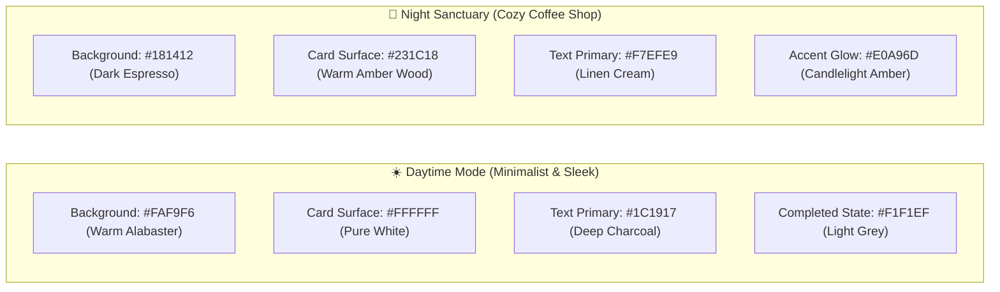

# Phase 5: Visual Design System & Design Tokens (DESIGN_SYSTEM.md)

> **Project Title:** Work-Study-Life Web Sanctuary  
> **Phase:** Phase 5 — Visual Design System & Tokens  
> **Aesthetic Direction:** Editorial Typography (Option A) + Dual-Atmosphere Color Space + Soft Pastel Sticky Tokens

---

## 1. Color Token Architecture

### A. The 5 Mood Sticky Note Tokens ("Read Me When")
Refined to soft, chic, non-intrusive pastels with **Angry updated to Pastel Sage Green** as directed by the Creative Director:

| Mood | Color Role | Hex Code | Swatch Preview | Visual Character |
| :--- | :--- | :--- | :--- | :--- |
| **Happy** | Soft Buttercup | `#FDF1BA` | `[  #FDF1BA  ]` | Warm morning sunshine, uplifting and cheerful |
| **Thankful** | Muted Lavender | `#E8DCF4` | `[  #E8DCF4  ]` | Serene, gentle gratitude and peace |
| **Angry** | Pastel Sage Green | `#D2E7D6` | `[  #D2E7D6  ]` | Soothing, de-escalating organic green *(Updated)* |
| **Lonely** | Blossom Rose Pink | `#FAD4DF` | `[  #FAD4DF  ]` | Tender, comforting warm floral hug |
| **Sad** | Powder Blue | `#D6E6F8` | `[  #D6E6F8  ]` | Soft sky rain, calming and reflective |

*Note: All 5 pastel colors remain fully customizable by the user via the `[✏️ Edit Colors]` pencil icon.*

---

### B. Dual-Atmosphere Palette Tokens



#### Daytime Mode Tokens (Minimalist & Sleek):
* `--bg-app`: `#FAF9F6` (Editorial warm ivory/alabaster — eliminates harsh glare)
* `--surface-card`: `#FFFFFF` (Crisp clean white cards)
* `--surface-completed`: `#EAEAE7` (Soft light grey for checked-off items)
* `--border-subtle`: `#E2E1DD` (Thin, architectural structural borders)
* `--text-primary`: `#1C1917` (Deep charcoal, warm black)
* `--text-secondary`: `#78716C` (Graphite muted tone)
* `--text-completed`: `#A8A29E` (Soft strike-through muted grey)

#### Night Sanctuary Mode Tokens (Cozy Coffee Shop):
* `--bg-app-night`: `#181412` (Deep roasted espresso background)
* `--surface-card-night`: `#231C18` (Warm coffee shop walnut / amber timber)
* `--border-night`: `#352B25` (Subtle dark bronze borders)
* `--text-primary-night`: `#F7EFE9` (Warm linen cream)
* `--text-secondary-night`: `#A8988E` (Soft latte foam tone)
* `--accent-glow-night`: `#E0A96D` (Candlelight amber accent on icons & jar glass)

---

## 2. Typography System (Option A: Editorial Serif + Modern Sans)

### Font Pairing Hierarchy
* **Display & Editorial Headings:** `Playfair Display`, `Cormorant Garamond`, or `Instrument Serif` (Editorial Serif)  
  * *Purpose:* Imparts high-fashion communication elegance to greetings (`Hi, Kaushiki`), page headers (`CALENDER`, `GOOD THINGS JAR`), and the `WIND UP THE DAY.` action.
* **UI Structure, Navigation & Body:** `Plus Jakarta Sans` or `Inter` (Geometric Modern Sans)  
  * *Purpose:* High-legibility clarity for timestamps (`11:00 - 01:00`), task descriptions, dates, and form controls.

```
Type Scale Blueprint:
+--------------------------------------------------------------------------+
| Level           | Font Family          | Size / Weight  | Tracking / Lead |
+--------------------------------------------------------------------------+
| Display Hero    | Editorial Serif      | 32px / SemiBold| -0.02em / 1.2   |
| (Hi, Kaushiki)  |                      |                |                 |
| Sub-Greeting    | Modern Sans          | 16px / Regular | Normal / 1.4    |
| (Good Afternoon)|                      |                |                 |
| Screen Header   | Modern Sans          | 15px / Bold    | +0.12em (Caps)  |
| (CALENDER, etc) |                      |                |                 |
| Section Date    | Editorial Serif      | 18px / Medium  | Normal / 1.3    |
| (Thursday, 15th)|                      |                |                 |
| Task Content    | Modern Sans          | 14px / Regular | Normal / 1.4    |
| Metadata/Times  | Modern Sans          | 12px / Medium  | +0.02em / 1.2   |
| Button Action   | Editorial Serif/Sans | 14px / SemiBold| +0.08em (Caps)  |
+--------------------------------------------------------------------------+
```

---

## 3. UI Component & Interaction Styling Tokens

### A. Task Item Box & Two-Step Completion
* **Default State:**
  * Background: `#FFFFFF` (Day) / `#231C18` (Night)
  * Border: `1px solid #E2E1DD`
  * Corner Radius: `10px`
  * Padding: `14px 18px`
* **Active Selected State (Tick Appears):**
  * Reveals an overlay check circle `[ ✓ ]` on the left/right.
* **Completed State:**
  * Background: `#EAEAE7` (Soft light grey)
  * Text Color: `#A8A29E` with subtle strike-through.
  * Border: `1px solid #D6D5D0`

### B. "WIND UP THE DAY." Button Token
* **Dimensions:** Full width container block, height `50px`.
* **Day State:** Deep charcoal `#1C1917` with white serif text `WIND UP THE DAY.`, letter-spacing `+0.1em`.
* **Hover / Tap:** Gentle scale transition `transform: scale(0.99)`.
* **Night Transition Effect:** Screen softly darkens into `#181412` while routing smoothly to `/jar`.

### C. The Tactile Sticky Note Token (Good Things Jar)
* **Surface:** Clean, unlined pastel square with gentle rounded corners (`12px`).
* **Shadow:** `box-shadow: 0 4px 16px rgba(0, 0, 0, 0.05), 0 1px 3px rgba(0, 0, 0, 0.03)` (tactile paper float).
* **Typography:** Clean readable sans or editorial serif with title input on top and body space below.
* **Color Customizer (`✏️`):** Pastel picker popover with live color swatch preview.

### D. Universal Bottom Navigation Dock
* **Placement:** Fixed bottom dock (centered max-width `460px` on desktop, full-bleed on mobile).
* **Atmosphere:** Frosted backdrop filter `backdrop-filter: blur(16px)`.
* **Elevated Add Button (`+`):**
  * Center icon elevated by `-10px` with a circular drop shadow.
  * Diameter `52px`, deep charcoal background with a crisp white plus icon.

---

## 4. Microcopy & Tone of Voice Guidelines

* **Dynamic Greetings:**
  * Morning (`4 AM – 12 PM`): *"Good Morning! Here is your clear path for today."*
  * Afternoon (`12 PM – 6 PM`): *"Good Afternoon! Keep steady, one step at a time."*
  * Evening (`6 PM – 11 PM`): *"Good Evening! Ready to ease into your night?"*
  * Late / Off-Hours: *"Welcome back! You're right on time."*
* **Zero Guilt Microcopy:**
  * Carried-over tasks in Scheduled page: *"Carried forward for fresh focus"* (no red alerts or shame badges).
  * Empty Good Things Jar: *"Your jar is waiting for its first little win. Tap above to drop a note."*
  * Empty Journal: *"A quiet blank page for your thoughts whenever you're ready."*
