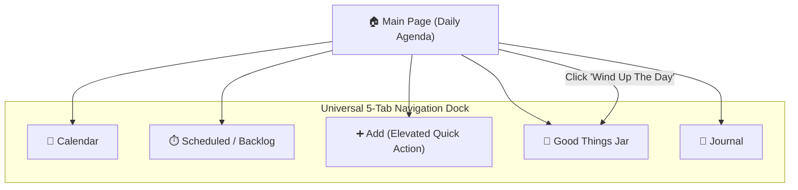
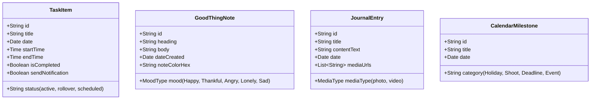

# Phase 3: Information Architecture & Taxonomy Specification (IA_SPEC.md)

> **Project Title:** Work-Study-Life Web Sanctuary  
> **Platform:** Responsive Web Application  
> **Phase:** Phase 3 — Information Architecture & Taxonomy  
> **Grounding:** Synthesized directly from Creative Director's 5 hand-drawn screen wireframes and interaction specs.

---

## 1. Global Navigation Schema & Floor Plan

The application uses a **Universal Bottom Dock Navigation** (5 primary destinations) coupled with a consistent **Top Context Header** across all secondary screens.

### Universal Navigation Destinations
1. **🏠 Main Page (Home):** Today’s chronological agenda, active task execution, weekly date strip, and the "Wind Up The Day" night transition.
2. **📅 Calendar (`/calendar`):** Monthly grid view, date drill-down, and major milestones / holidays / deadline cards.
3. **⏱️ Pending & Scheduled (`/scheduled`):** Automatic backlog repository for leftover tasks, advance scheduled tasks, and evening chores.
4. **➕ Add Task Modal (`/add`):** Fast creation modal for tasks, event milestones, time slots, and notification alerts.
5. **🫙 Good Things Jar (`/jar`):** Tactile sticky note creator with 5 customizable mood palettes, glass jar vault, and "Read Me When" mood filter.
6. **📖 My Journal (`/journal`):** 3-way reflection hub (List [default], Calendar, Media) with rich text & photo/video uploads.

---

## 2. Screen-by-Screen Component & Content Inventory

### Screen 1: Main Page (Daily Focus Dashboard)
* **Top Header:** 
  * Personalized greeting: `Hi, Kaushiki / Good Afternoon!` (dynamic day/evening greeting).
  * Profile Avatar icon (links to account & theme preferences).
* **Weekly Strip Slider:**
  * Month indicator badge (`OCTOBER`).
  * Horizontal 7-day pill row (`Mon 12` to `Sun 18`) with the active day prominently circled.
* **Daily Agenda Timeline:**
  * Active day header: `Thursday, 15th`.
  * Chronological task blocks (e.g., `11:00 - 01:00 Zoom meeting`, `03:00 Explore Blender`, `07:00 Laundry`).
  * **Single-Click Interaction:** Tapping a task reveals a swift checkmark button; tapping completes the item with an immediate visual color transition.
* **Day-End Sanctuary Trigger:**
  * Full-width action button: **`WIND UP THE DAY.`**
  * **Trigger Action:** Activates the warm ambient "Cozy Night Sanctuary" theme and smoothly navigates the user directly to the **Good Things Jar**.

---

### Screen 2: Calendar Page (`/calendar`)
* **Top Bar:** `[Home 🏠]` (left), `CALENDER` title (center), `[Profile 👤]` (right).
* **Month Navigation:** Month/year header with arrow controls (`< OCTOBER 2026 >`).
* **Interactive Monthly Grid (7x5):**
  * Today’s date filled/highlighted (e.g., `15`).
  * Marked milestone dates circled (e.g., `16`, `20`).
  * **Date Click Behavior:** Tapping any date updates the cards below to show scheduled items for that date.
* **Milestone & Holiday Feed:**
  * Card-based list for major events, deadlines, and holidays (e.g., `Fri 16: Shoot Day`, `Tue 20: Dusshera`).
  * Option to add custom holidays and high-level milestones.

---

### Screen 3: Pending / Scheduled Page (`/scheduled`) & Add Task (`/add`)
* **Pending / Scheduled Logic:**
  * Serves as the dedicated home for **leftover uncompleted tasks** that roll over from the day.
  * Preserves daytime focus by isolating backlog items and evening chores from today's primary agenda.
  * Day selector pill row (`12, 13, 14, 15`) with a quick `(+)` add button.
* **Add Task Modal / Page:**
  * **Task Title:** Text input (e.g., *Clean Room*).
  * **Date Selector:** `[Date ▼]` & `[Month ▼]` dropdown selectors.
  * **Time Range Selector:** `ON TIME` scrollable pickers (`Start Time` – `End Time`).
  * **Send Notification Toggle:** Optional time-triggered reminder alert toggle.

---

### Screen 4: Good Things Jar (`/jar`) — "Read Me When" System
* **Sticky Note Writing Canvas:**
  * Sticky note aesthetic (clean, tactile pastel block, unlined).
  * **Heading Input:** Short title for the memory.
  * **Body Input:** Freeform reflection text.
  * **Edit Colors (Pencil Icon):** Customizer for the 5 mood-associated pastel colors.
* **The 5 Core Mood Categories:**
  * 🟡 **Yellow:** Happy
  * 🟣 **Purple:** Thankful
  * 🔴 **Red:** Angry
  * 🌸 **Pink:** Lonely
  * 🔵 **Blue:** Sad
* **Actions:**
  * **`PUT IT TO THE JAR`:** Submits the note; animates as a folded origami note dropping into the visual glass jar.
  * **`READ FROM JAR.`:** Opens the "What do you want to Read?" drawer with mood filters (`[ ] Happy`, `[ ] Thankful`, `[ ] Angry`, `[ ] Sad`, `[ ] Lonely`, `[x] ALL`).
  * **Reading Experience:** Tapping notes in the jar opens an elegant, tactile floating card carousel.

---

### Screen 5: My Journal (`/journal`) — 3 Dynamic Views
* **Top Navigation:** `[Home 🏠]`, `My Journal`, `[Profile 👤]`.
* **Segmented 3-Way View Switcher:** `[ Calender ]` | `[ Media ]` | `[ List (Default) ]`
* **Views Breakdown:**
  1. **List View (Default):** Chronological feed of journal entries with date badges (`THRU 15`), heading, preview snippet, and photo/video thumbnail on the right.
     * Features a floating **`(+)`** button at the bottom to compose a new entry.
  2. **Calendar View:** Multi-month visual overview (e.g., Oct, Nov, Dec 2026) showing date markers where entries were recorded. Tapping a date opens that entry.
  3. **Media View:** Visual masonry gallery filtered by `[All]`, `[Photo]`, and `[Video]` tags with date stamps.
* **Entry Composition:** Supports combining rich text alongside photo and video attachments.

---

## 3. Taxonomy & Data Model

---

## 4. Mode Transition State Matrix

| State Parameter | Daytime Mode | Night Sanctuary Mode |
| :--- | :--- | :--- |
| **Trigger** | Default daytime state | Clicking **"WIND UP THE DAY."** button |
| **Atmosphere & Palette** | Sleek, minimal, high-contrast, focused | Cozy warm coffee shop, amber ambient glow, soft textured paper |
| **Primary Screen Focus** | Main Page (Agenda & Time-blocks) | Good Things Jar & My Journal |
| **Cognitive Load** | Execution-driven, fast single-tap completion | Reflective, slow, calming, sensory closure |
