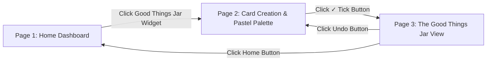
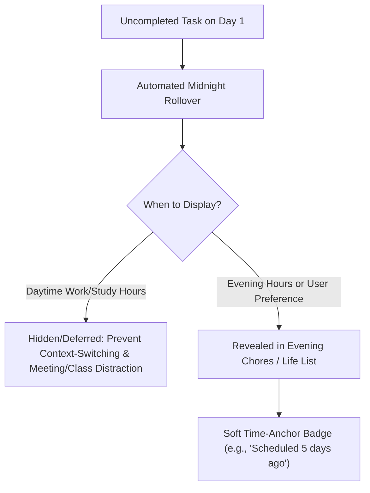

# Phase 2: User Journey & Wireframe Specification (Reboot)

> **Project Phase:** Phase 2 — Empathy & User Experience Modeling  
> **Core Focus:** Screen Flow, Good Things Jar Wireframe, & Rollover Logic  
> **Target Platform:** Responsive Web Application

---

## 1. Good Things Jar: 3-Step Interactive Wireframe

Based on the Creative Director's wireframe sketch, the **Good Things Jar** experience is structured into a seamless 3-step tactile flow:

### Detailed Screen Breakdown

#### Screen 1: Dashboard Entry Point
* **Location:** Prominent card widget on the main dashboard.
* **Trigger:** Clicking the **Good Things Jar** widget navigates directly to the Card Creation view.

#### Screen 2: Tactile Index Card Creation
* **Color Palette Selector:** Users can choose and customize their card colors (featuring pastel color options like **Pastel Blue**, **Pastel Pink**, **Pastel Yellow** as default presets).
* **Card Canvas:** Styled like a tactile lined index card for typing positive moments, wins, or gratitude.
* **Submission Action:** A prominent **✓ Tick Button** in the bottom-right corner submits the completed card into the jar.

#### Screen 3: The Good Things Jar View
* **Visual Presentation:** An illustrated clear glass jar visibly filled with all the earlier memory cards dropped and saved by the user over time.
* **Header Controls:**
  * 🏠 **Home Button (Top-Left):** Quick navigation back to the main dashboard.
  * ↩️ **Undo Button (Top-Right):** Instant recall if the tick button was clicked by mistake.
* **Bottom Controls:**
  * 📖 **Read & Empty Jar:** Allows the user to unroll past notes, review memories, or clear out the jar for a fresh start.

---

## 2. Rollover Task Mechanics & Context-Aware Timing

### Carry-Over Protocol & Timing Control
1. **Context-Aware Display (Evening Visibility):** Rollover tasks (especially domestic chores like laundry, cleaning, groceries) stay out of sight during peak morning/afternoon study and work hours so users are not distracted during classes or meetings.
2. **User Scheduling Preference:** The system displays rollover badges in the evening by default (or asks the user their preferred time for domestic/rollover catch-up).
3. **Soft Time Badges:** Rather than punishing red alerts, tasks feature subtle, non-judgmental labels (e.g., *"Scheduled 5 days ago"*).
4. **No Quote Clutter:** Clean, focused workspace without generic daily quotes.

---

## 3. "Wind Down Day" Manual Mode Transition

* **Timing Context:** Designed for mid-evening to late night (typically around **9:00 PM** or whenever the user finishes work and is preparing for bed).
* **100% User-Driven:** The transition from **Minimalist Sleek Day Mode** to **Cozy Coffee Shop Night Sanctuary** is triggered **strictly when the user clicks the "Wind Down Day" button**.
* **Night Sanctuary Focus:** Work metrics, deadlines, and study lists fade away. The screen shifts into an ambient warm coffee shop sanctuary where the **Daily Journal** and **Good Things Jar** take center stage.
* **Low-Friction Routine:** The Good Things Jar is intentionally fast and effortless (takes under 1 minute) so the user gets a satisfying close to their day without cognitive effort.

---

## 4. Journey Matrix: Day-to-Night Workflow

| Time Anchor | User Mindset | Active Screen / Feature | UI Tone & Aesthetic |
| :--- | :--- | :--- | :--- |
| **Morning Launch (7–9 AM)** | Rushed, seeking top targets | **1-Minute Priority Dashboard** (High-priority study/work only; no rollover clutter) | Minimalist, high contrast, clean. |
| **Daytime Execution (10 AM–5 PM)** | Deep focus, classes & meetings | **Work & Study Sequenced Lists** (Zero distraction from domestic chores) | Sleek, distraction-free grid. |
| **Early Evening (6–8 PM)** | Post-work/college, home chores | **Evening Chores & Rollover Review** (Laundry, groceries, soft rollover badges appear) | Balanced, gentle domestic check-in. |
| **Mid-Evening / Night (~9 PM / Bedtime)** | Work finished, unwinding | **Manual "Wind Down Day" Button Click** | Soft, ambient visual shift. |
| **Night Sanctuary & Reflection** | Peaceful, gratitude before sleep | **Night Sanctuary: Good Things Jar & Tactile Paper Journal** (Quick 1-minute positive card drop) | Warm Coffee Shop glow, cozy textures, pastel index cards. |
