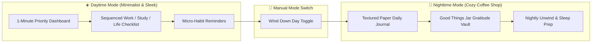

# Phase 1: UX Research & Product Vision Spec (Reboot)

> **Project Title:** Work-Study-Life Web Sanctuary  
> **Platform:** Responsive Web Application  
> **Target Audience:** Ages 18–32 (Students & Young Professionals navigating burnout, erratic routines, and habit inconsistency)  
> **Aesthetic Paradigm:** Dual-Mode Shift — *Minimalist Sleek (Day)* ➔ *Cozy Coffee Shop Sanctuary (Night)*

---

## 1. Executive Summary & Creative Vision

### The Core Problem Space
Young adults (ages 18–32) face a vicious cycle of **time slippage and cognitive fatigue**:
* **Rushed Mornings:** Waking up 30 minutes before college or work, skipping breakfast, and diving blindly into the day.
* **Chaotic Afternoons:** Context-switching between work, study, and personal errands without clear task prioritization.
* **Unwinding Doomscroll Cycle:** Ending the night scrolling endlessly on social media because they lack a satisfying visual or mental "end-of-day" stopping point.
* **Health & Habit Drop-off:** Forgetting customizable daily micro-habits (e.g., chia seeds, hydration, dry fruit soaking, sleep routines, or any user-defined health anchors) due to lack of gentle reminders.

### The Solution: Dual-Aesthetic Web Sanctuary
A web application built around a **Dual-Aesthetic System**:
1. **Daytime Execution Mode (Minimalist & Sleek):** Crisp, distraction-free UI focused on the *Sequenced Daily Agenda* across Work, Study, and Life, featuring an instant 1-minute priority highlight dashboard upon launch.
2. **Nighttime Reflection Mode (Cozy Warm Coffee Shop):** A warm, ambient aesthetic featuring a textured paper *Daily Journal* and a nostalgic *Good Things Jar* memory vault to replace doomscrolling with calm gratitude.

---

## 2. Dual-Aesthetic System Specifications

| Aesthetic Dimension | Daytime Execution Mode | Nighttime Reflection Mode |
| :--- | :--- | :--- |
| **Visual Vibe** | Minimalist, sleek, structured, high-clarity. | Warm coffee shop atmosphere, cozy lighting, soft ambient glow. |
| **Texture & Material** | Clean digital cards, sharp typography, subtle grid layout. | Tactile aesthetic paper, warm tones, jar glass reflection. |
| **Focus Goal** | Fast execution, immediate task clarity, no distraction. | Relaxation, emotional closure, gratitude, zero work stress. |
| **Key Features Active** | 1-Min Priority Checklist, Work-Study-Life Agenda, Reminders. | Daily Journal, Good Things Jar, Nightly Wellness Notes. |

---

## 3. Hero Feature Architecture: "The 1-Minute Priority Dashboard"

### Purpose & User Story
> *"As a rushed student or young professional opening my laptop 30 minutes before my day starts, I want to immediately see my top priority tasks for this exact time and date, so I never miss critical deadlines even when I am in a hurry."*

### UI Design Principles
* **Zero-Lag Instant View:** The very first screen upon launching the app highlights the top 3 high-priority tasks in bold, time-sensitive blocks.
* **Tri-Category Categorization:**
  * 🔴 **Work:** Hard deadlines, client work, job obligations.
  * 🟡 **Study:** Assignments, research, studio projects.
  * 🟢 **Life & Wellness:** Meals, hydration, micro-habits, household errands.

---

## 4. Complete Feature Inventory & Taxonomy

### Core Pillars & Functions

1. **Sequenced Daily Agenda (Work / Study / Life):**
   * Chronological time-blocked agenda.
   * Color-coded category tags.
   * Auto-rollover engine for incomplete items with zero-guilt microcopy (surfaced in the evening or configured by user to protect daytime focus).

2. **Micro-Habit & Consistency Tracker:**
   * Daily non-negotiable health anchors (fully customizable templates, e.g., Morning Chia Seeds, Night Dry Fruits, Hydration, Reading).
   * Visual streak consistency indicators without punishing breaks.

3. **Quick Notes & Scratchpad:**
   * Rapid-capture space for thoughts, ideas, links, and temporary checklists.

4. **Cozy Coffee Shop Evening Journal:**
   * Styled like an aesthetic paper notebook.
   * Freeform writing, daily mood tags, and reflection prompts.

5. **The "Good Things Jar":**
   * Interactive digital jar to drop positive moments, wins, and grateful thoughts.
   * Nostalgic coffee-shop lighting and tactile card drop animations.

---

## 5. Real-World User Empathy Diagnostic (Ages 18–32)

| Life Moment | User Action & State | Emotional Need | Web App Solution & Interface |
| :--- | :--- | :--- | :--- |
| **7:30 AM (Wake Up)** | Rushing out, late for office/college, skipping breakfast. | Immediate clarity without decision fatigue. | **Hero Dashboard:** Instantly displays top 3 high-priority tasks + morning habit prompt. |
| **1:00 PM (Midday)** | Juggling work deadlines and study assignments. | Focused execution, clear categorization. | **Minimalist Sleek Checklist:** Work vs. Study vs. Life filters keep items organized (domestic rollovers hidden). |
| **6:30 PM (Evening)** | Finishing work, chores waiting (laundry, cooking). | Gentle reminders, smart rollover support. | **Evening Chore & Rollover Slot:** Rollover tasks/badges surface now so users can handle domestic chores. |
| **10:30 PM (Night)** | Exhausted, prone to doomscrolling on phone in bed. | Emotional unwind, calm stopping point. | **Cozy Coffee Shop Mode:** "Wind Down Day" button opens paper journal & Good Things Jar. |
