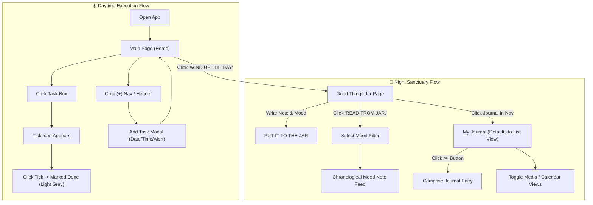

# Phase 4: Low-Fidelity Wireframes & User Interaction Flows (WIREFRAMES.md)

> **Project Title:** Work-Study-Life Web Sanctuary  
> **Phase:** Phase 4 — User Flows & Low-Fidelity Wireframes  
> **Grounding:** Synthesized directly from Creative Director's annotated interaction blueprints.

---

## 1. Visual Overview & Hand-Drawn Blueprints

The interaction system is documented directly from your annotated sketches:

### Screen Group 1: Main Page & Calendar Page


### Screen Group 2: Scheduled Page & Add Task Page


### Screen Group 3: Journal 3-Way Views & Good Things Jar


---

## 2. Screen-by-Screen Layouts & Micro-Interactions

### Screen 1: Main Page (Home Dashboard)

```
+-------------------------------------------------------+
|  Hi, Kaushiki                               [Profile] |
|  Good Afternoon! (Dynamic Greeting)                   |
|  +-------------------------------------------------+  |
|  | [OCTOBER]                                       |  |
|  |  Mon 12   Tue 13   Wed 14  (15)  Fri 16  Sat 17 |  |
|  +-------------------------------------------------+  |
|                                                       |
|  Thursday, 15th                                       |
|  +-------------------------------------------------+  |
|  | 11:00-01:00  [ Zoom meeting for TSR Pres...   ] |  |
|  | 03:00        [ Explore Blender                ] |  |
|  | 07:00        [ Laundry                        ] |  |
|  +-------------------------------------------------+  |
|                                                       |
|  [ WIND UP THE DAY.                                 ] |
+-------------------------------------------------------+
|  [📅 Cal]   [⏱️ Sched]   [(+) Add]   [🫙 Jar]   [📖 Jrnl] |
+-------------------------------------------------------+
```

#### Detailed Interaction Specifications:
1. **Dynamic Greeting Engine:**
   * `04:00 AM – 12:00 PM` ➔ **"Good Morning!"**
   * `12:00 PM – 06:00 PM` ➔ **"Good Afternoon!"**
   * `06:00 PM – 11:00 PM` ➔ **"Good Evening!"**
   * Late hours / off-hours ➔ **"Welcome back!"**
2. **Two-Step Task Completion:**
   * **Step 1:** User clicks/taps on any active task box ➔ an overlay checkmark icon (`✓`) appears.
   * **Step 2:** User clicks the checkmark ➔ task marks as complete, text softly strikes through, and the card background transitions to **light grey**.
3. **"WIND UP THE DAY" Action:**
   * **100% User Autonomy:** It is entirely up to the user when they want to wind up their day (whether at 8:00 PM, 11:00 PM, or 2:00 AM after finishing late work). The app never forces a cutoff.
   * Clicking this button initiates the cozy evening transition and **automatically routes the user directly to the Good Things Jar**, with a clear pathway to proceed into the **Journal Page**.

---

### Screen 2: Calendar Page (`/calendar`)

```
+-------------------------------------------------------+
| [🏠 Home]               CALENDER            [Profile] |
|                 <  OCTOBER 2026  >                    |
|  Mon  Tue  Wed  Thu  Fri  Sat  Sun                    |
|              1    2    3    4                         |
|   5    6    7    8    9   10   11                         |
|  12   13   14  (15) (16)  17   18   <-- (15) Today's  |
|  19  (20)  21   22   23   24   25        circled date |
|  26   27   28   29   30   31                          |
|                                                       |
|  [ Mark a date                              (+) ]     |
|                                                       |
|  Systematic Event Feed:                               |
|  +-------+-----------------------------------------+  |
|  | Fri 16| Shoot Day                               |  |
|  +-------+-----------------------------------------+  |
|  | Tue 20| Dusshera                                |  |
|  +-------+-----------------------------------------+  |
+-------------------------------------------------------+
|  [📅 Cal]   [⏱️ Sched]   [(+) Add]   [🫙 Jar]   [📖 Jrnl] |
+-------------------------------------------------------+
```

#### Detailed Interaction Specifications:
1. **Month Navigation Arrows:**
   * Left arrow (`<`): Navigates back (e.g., September 2026).
   * Right arrow (`>`): Navigates forward (e.g., November 2026).
   * The grid updates automatically to reflect the selected month.
2. **"Mark a date (+)" Feature:**
   * Clicking `Mark a date (+)` allows the user to select any date on the calendar and attach a custom milestone, holiday, or event.
   * Opens the selected date view (e.g., `17th OCT | Swati's Bday | 7th day of Dussehra`).
3. **Chronological Feed:** All marked milestones appear below the calendar systematically ordered by date (e.g., 16th, 17th, 20th).

---

### Screen 3: Scheduled / Pending Page (`/scheduled`)

```
+-------------------------------------------------------+
| [🏠 Home]              SCHEDULED            [Profile] |
| Thrus. 15th October                                   |
| [Mon 12] [Tue 13] [Wed 14] [Thrus 15]     [(+) Add]   |
|                                                       |
| 07:30 pm  [ Budget Review                           ] |
| 08:00 pm  [ Laundry                                 ] |
| 11:00 pm- [ Work on TBR Presentation                ] |
| 01:00 am  [                                         ] |
| 02:00 am  [ Finish MTA PPT                          ] |
+-------------------------------------------------------+
|  [📅 Cal]   [⏱️ Sched]   [(+) Add]   [🫙 Jar]   [📖 Jrnl] |
+-------------------------------------------------------+
```

#### Detailed Interaction Specifications:
1. **Backlog & Rollover Function:** Displays tasks left incomplete on previous dates or scheduled for evening hours, serving as a clean filter/reminder without cluttering the daytime Main Page.
2. **Historical Day Filtering:** Clicking any previous date pill (e.g., Mon 12, Tue 13) filters the list to view work that was left undone on that day.
3. **Fast Quick-Add (`(+)`):** The `(+)` button in the date header immediately redirects to the **Add Task Page**. Any task added here links directly to that selected date!

---

### Screen 4: Add Task Page (`/add`)

```
+-------------------------------------------------------+
| [🏠 Home]              ADD TASK             [Profile] |
|                                                       |
| TASK TITLE:                                           |
| [ Clean Room                                        ] |
|                                                       |
| ON:                                                   |
| [Date: 15 ▼]        [Month: OCT ▼]      [Year: 2026 ▼]|
|                                                       |
| ON TIME:                                              |
| [ 09:00 AM  ▼ ]  --to--  [ 01:00 PM  ▼ ]              |
|                                                       |
| Send Notification:                                    |
| [✓] Enable Alert   ( ) Once     ( ) Permanently       |
+-------------------------------------------------------+
|  [📅 Cal]   [⏱️ Sched]   [(+) Add]   [🫙 Jar]   [📖 Jrnl] |
+-------------------------------------------------------+
```

#### Detailed Interaction Specifications:
1. **Dropdown Selectors:**
   * **Date:** Dropdown expands to day numbers (`15, 16, 17, 18...`).
   * **Month:** Dropdown shows months (`OCT, NOV, DEC, JAN...`).
   * **Year:** Dropdown shows years (`2026, 2027, 2028...`).
2. **Time Selectors:** Easy scroll/select start time and end time.
3. **Notification Cadence:**
   * Only activates when checked.
   * User can select between **"Once"** (one-time reminder) or **"Permanently"** (recurring habit/schedule alert).

---

### Screen 5: Good Things Jar (`/jar`)

```
DEFAULT CREATION PAGE                   READING / FILTERED VIEW
+-------------------------------------+ +-------------------------------------+
| [🏠]     GOOD THINGS JAR   [Profile]| | [🏠]     GOOD THINGS JAR   [Profile]|
| Thrus. 15th OCT        [✏️ Edit Clrs]| | OCTOBER 2026                        |
| +---------------------------------+ | | +---------------------------------+ |
| | [Good Presentation Day        ] | | | | Heading: Great Critique Session | |
| | Freeform text writing space...  | | | | 5th Oct, 2026                   | |
| | (Tactile plain sticky note)     | | | +---------------------------------+ |
| +---------------------------------+ | | +---------------------------------+ |
|                                     | | | | Heading: Studio Progress      | |
| READ ME WHEN Mood Selector:         | | | | 9th Oct, 2026                   | |
| [x] 🟡 Happy      [ ] 🟣 Thankful   | | +---------------------------------+ |
| [ ] 🔴 Angry      [ ] 🌸 Lonely     | | +---------------------------------+ |
| [ ] 🔵 Sad                          | | | | Heading: Morning Coffee Win   | |
|                                     | | | | 10th Oct, 2026                  | |
| [ PUT IT TO THE JAR               ] | | +---------------------------------+ |
| [ READ FROM JAR.                  ] | |                                     |
+-------------------------------------+ +-------------------------------------+
```

#### Detailed Interaction Specifications:
1. **Tactile Sticky Note Canvas:** Styled as a clean, plain pastel sticky note (no lined paper). Includes **Heading** input and freeform reflection text.
2. **Edit Colors (`✏️`):** Opens a pastel palette picker to customize the 5 mood color assignments.
3. **"PUT IT TO THE JAR":** Drops the note into the jar with a smooth drop animation.
4. **"READ FROM JAR.":** 
   * Opens the drawer modal: *"What do you want to Read?"* (`Happy`, `Thankful`, `Angry`, `Lonely`, `Sad`, `ALL`).
   * Selecting a mood (e.g., **Happy**) takes the user to the chronological feed of all notes created under that mood color!

---

### Screen 6: My Journal (`/journal`) — 3 Dynamic Views

```
PAGE 1: LIST VIEW (DEFAULT)   PAGE 2: MEDIA VIEW            PAGE 3: CALENDAR VIEW
+---------------------------+ +---------------------------+ +---------------------------+
| [🏠]  MY JOURNAL  [Prof]  | | [🏠]  MY JOURNAL  [Prof]  | | [🏠]  MY JOURNAL  [Prof]  |
| [List] | Media | Calender | | List | [Media] | Calender | | List | Media | [Calender] |
|                           | | [All]  [Photo]  [Videos]  | | Mon Tue Wed Thu Fri Sat Sun |
| SAT 10  Heading      [img]| | +----------+ +----------+ | | 12  13  14  15  16  17  18|
|         Text preview [   ]| | | 15 OCT   | | 16 OCT   | | | 19  20  21  22  23  24  25|
|                           | | +----------+ +----------+ | | 26  27  28  29  30  31    |
| THRU 15 Heading      [img]| | +----------+ +----------+ | |                             |
|         Text preview [   ]| | | 17 OCT   | | 20 OCT   | | | NOV 2026                    |
|                           | | +----------+ +----------+ | | (Dates feature background   |
| FRI 16  Heading      [img]| |                           | |  image thumbnails of media) |
|         Text preview [   ]| |                           | |                             |
|                           | |                           | |                             |
|              [✏️ Add/Edit] | |                           | |                             |
+---------------------------+ +---------------------------+ +---------------------------+
```

#### Detailed Interaction Specifications:
1. **View 1: List View (Page 1 — DEFAULT):**
   * Chronological journal card list showing date pill on the left (`SAT 10`, `THRU 15`), text preview (clean plain text), and square media thumbnail on the right.
   * Floating **Pencil button (`✏️`)** in the bottom-right corner to **Add or Edit Journal entries**.
2. **View 2: Media View (Page 2):**
   * Filter tabs: `[All]`, `[Photo]`, `[Videos]`.
   * Photo & video grid with dates tagged on each item (`15 OCT`, `16 OCT`, etc.).
3. **View 3: Calendar View (Page 3):**
   * Multi-month display (October, November 2026).
   * Dates that have entries feature a subtle **background thumbnail image** of the media uploaded by the user on that day!

---

## 3. End-to-End User Flow Architecture


